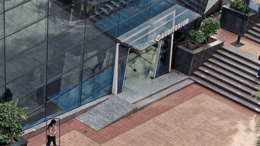
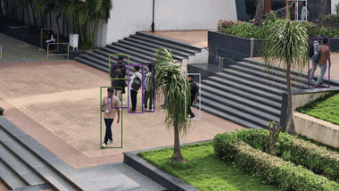
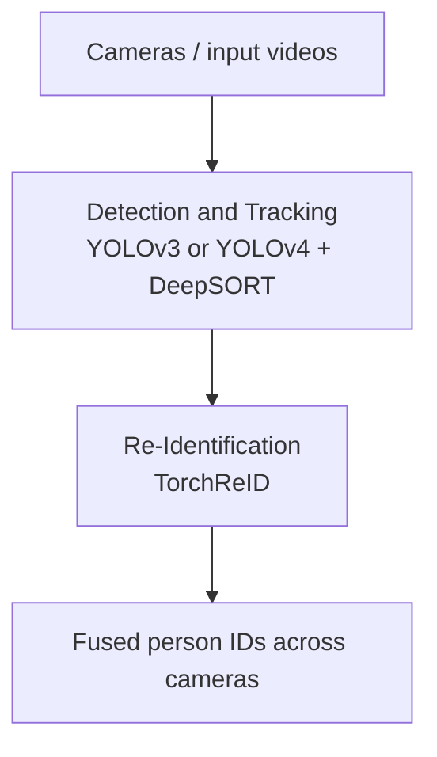
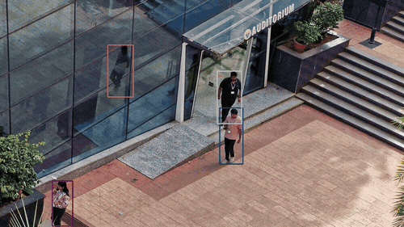

# _Multi-Camera Person Tracking and Re-Identification_ (using video)

Simple model to _"Detect/Track"_ and _"Re-identify"_ individuals in different cameras/videos.

  



<p align="center">
  
</p>

## Introduction
This project aims to track people in different videos accounting for different angles.

The framework used to accomplish this task relies on MOT and ReID to track and re-identify IDs of humans, respectively.
The tracking can be completed using YOLO_v3 or YOLO_v4 and ReID relies on KaiyangZhou's Torchreid library.

## What's included in this repository
All source code, configuration files and the demo videos are included. The model weights are **not** committed (they exceed GitHub's file size limits and are covered by `.gitignore`), so they must be added locally before running the demo:

| Path | Used for | How to get it |
| --- | --- | --- |
| `model_data/models/yolov3.h5`, `yolov4.h5` | YOLO detectors | Download pre-trained `.h5` or convert Darknet weights (see [Models](#models)) |
| `model_data/models/model.pth` | ReID | Download from the links in [Models](#models); the path is hardcoded in `reid.py` |
| `model_data/models/mars-small128.pb` | DeepSORT appearance features | Take it from [Qidian213/deep_sort_yolov3](https://github.com/Qidian213/deep_sort_yolov3) (`model_data/mars-small128.pb`) |
| `videos/init/*.mp4` | Input videos | Included (`1.mp4`, `2.mp4`, `3.mp4` — the clips used in the demo below) |
| `videos/output/tracking.mp4`, `videos/output/Complete.mp4` | Results (tracking / tracking + ReID) | Included as converted previews; `demo.py` regenerates them as full-quality `.avi` locally |

## Installation
 - Download [Anaconda](https://www.anaconda.com/products/individual) if it is not installed on your machine

 - Clone the repository
```python
git clone https://github.com/Bucke200/AI-and-ML-enabled-video-analysis-and-interpretation
```
 - Create a project environment
```python
cd AI-and-ML-enabled-video-analysis-and-interpretation
conda create --name py37 python=3.7
conda activate py37
```
Python 3.7 is required: the project pins `tensorflow==1.15` and `keras==2.3.1`, which do not support newer Python versions.

 - Install dependencies
```python
pip install -r requirements.txt
```
 - Install torch and torchvision based on the cuda version of your machine
```python
conda install pytorch torchvision cudatoolkit -c pytorch
```

## Models

All model files go into `model_data/models/`.

### Pre-trained models (.h5) (if you want to start right away)
 - Download the Keras models for [YOLO_v3](https://drive.google.com/file/d/1a7JI-A920lrdt6OKya-qCXx-5ZUWvkMg/view?usp=sharing) and [YOLO_v4](https://drive.google.com/file/d/1pwFo4aHKPi0ztpL5tEYaXIr8RltYYQeY/view?usp=sharing) and add them to `\model_data\models\` as `yolov3.h5` and `yolov4.h5`

 - Download either one of the following Torchreid models [1](https://drive.google.com/file/d/1EtkBARD398UW93HwiVO9x3mByr0AeWMg/view?usp=sharing), [2](https://drive.google.com/open?id=15Ayri_sHtrctJ1Zb8qERjvdi66y6QaI4) and add it to `\model_data\models\` as `model.pth` (the path is hardcoded in `reid.py`, so rename it if needed)

 - Add `mars-small128.pb` (DeepSORT ReID encoder) to `\model_data\models\` from [Qidian213/deep_sort_yolov3](https://github.com/Qidian213/deep_sort_yolov3)

### Convert models (alternative to the pre-trained .h5 files)
 - Download the YOLO models for [YOLO_v3](https://drive.google.com/file/d/18fmQMegNsAzPte7tJeCxwf1iE8JUTQhQ/view?usp=sharing) and [YOLO_v4](https://drive.google.com/file/d/1w9furPagm3KytRW2uNooLcBoiYWDwbop/view?usp=sharing) and add them to `/model_data/weights/`
 * YOLO_v3
```python
python convert_y3.py model_data\weights\yolov3.weights model_data\models\yolov3.h5
```
 * YOLO_v4
```python
python convert_y4.py model_data\weights\yolov4.weights model_data\models\yolov4.h5
```

## Demo

You can try out your own videos by running `demo.py`.
Videos are passed with `--videos`; multiple videos are stitched together and tracked across, so a person moving from one camera to another is re-identified with the same ID.
You should specify the path of the videos and the version of YOLO you would like to use (v3 or v4).

```python
python demo.py --videos videos\init\1.mp4 videos\init\2.mp4 videos\init\3.mp4 --version v3
```

Under the directory `\videos\output`, the program will generate:
 * `tracking.avi` — a video of the tracking
 * `Complete.avi` — a video of the tracking and ReID (as can be seen in the example above)
 * `tracking.txt` — the tracking results in MOT format

Converted previews of both output videos are included in the repository: `videos/output/tracking.mp4` and `videos/output/Complete.mp4`.
